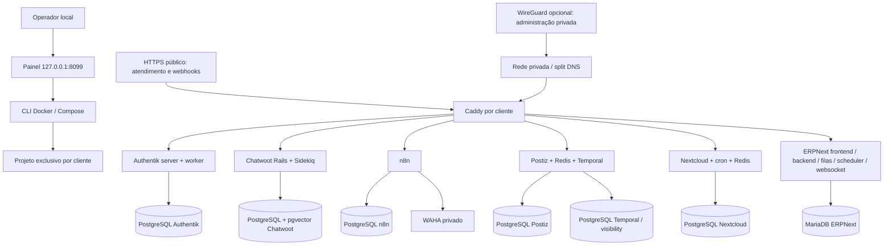

# Arquitetura

> Estado mais recente: o Postiz foi corrigido e retomado como ferramenta principal; Mixpost permanece como alternativa. Consulte [POSTIZ-CORRIGIDO.md](POSTIZ-CORRIGIDO.md) para os resultados atuais. Os relatos anteriores abaixo sao historicos.

> Atualização: o componente de mídias atual é Mixpost Lite, substituindo Postiz e Temporal. Consulte [MIXPOST.md](MIXPOST.md) para a implantação, testes e limitações atuais. Referências ao Postiz abaixo registram a arquitetura anterior e não configuram o Mixpost.

Cada cliente é um projeto Compose `vw-<id>`, com nomes de volumes e redes próprios. O gerador produz JSON aceito diretamente como Compose; não depende de bibliotecas YAML. O painel roda no Windows com o Node existente, em loopback, e chama o CLI Docker sem shell. Nenhum container recebe o socket do Docker.

## Componentes

| Função | Composição |
|---|---|
| Identidade | Authentik server + worker + PostgreSQL; sem socket Docker/outposts automáticos |
| Atendimento | Chatwoot Rails, Sidekiq, inicializador de banco, PostgreSQL com pgvector, Redis dedicado |
| WhatsApp | WAHA Core em loopback, chave API e login do dashboard, sessões e mídia persistentes |
| Automação | n8n + PostgreSQL, chave de criptografia persistente, expurgo de execuções em 168 horas |
| Mídias | Postiz, PostgreSQL 17, Redis e Temporal 1.28 com PostgreSQL 16 dedicado |
| Arquivos | Nextcloud Apache + cron + PostgreSQL + Redis |
| ERP | ERPNext 16.53, MariaDB 11.8, Redis cache/queue, configurador, criação de site, backend, frontend, websocket, worker e scheduler |
| Ingress | Caddy, TLS local ou ACME, volumes de certificados, rotação de logs do Docker |
| VPN | WireGuard em profile `vpn`, não iniciado no piloto local; depende de kernel/rotas/DNS/endpoint reais |

Nextcloud complementa o ERP com arquivos e colaboração; não substitui os módulos financeiros/estoque do ERPNext. Não há LDAP separado: Authentik atende OIDC/SAML; um outpost LDAP pode ser adicionado quando houver aplicação que o exija.

## Dados e fronteiras

Seis servidores PostgreSQL por cliente (Authentik, Chatwoot, n8n, Postiz, Temporal e Nextcloud), com credenciais aleatórias independentes; Temporal cria também seu banco de visibility. ERPNext tem MariaDB próprio por cliente, com usuário do site criado pelo `bench`. Nenhum desses servidores publica portas no host.

Os usuários de inicialização do PostgreSQL são administradores de suas instâncias dedicadas. A separação impede compartilhar credenciais entre aplicações, mas não aplica privilégio mínimo dentro de cada instância. Antes de produção, migre cada aplicação para um papel sem superusuário conforme as migrações exigidas; preserve os administradores apenas para provisionamento/backup. Não compartilhe uma dessas instâncias entre clientes sem refazer privilégios e políticas.

Redes de banco são separadas por aplicação. O ingress compartilha a rede `proxy` apenas com as aplicações HTTP. As redes são exclusivas do projeto, mas o Docker/Windows e os administradores continuam sendo uma fronteira compartilhada: Compose não é isolamento equivalente a uma VM nem implementa NetworkPolicy Kubernetes. Um host comprometido compromete seus clientes. Para clientes de exigência alta, use VM/host por cliente.

Redis não é publicado. O acesso depende da rede Docker privada; não foi configurada autenticação Redis nesta base. As aplicações têm saída para integrações externas. Não há limitação de egress, segmentação L7 ou controle de recursos por cliente além de limites individuais de memória e rotação de logs.

Segredos ficam no runtime privado, fora do Git, e são injetados no Compose. Administradores do host podem vê-los por `docker inspect`. Para produção, adote um gerenciador de segredos e cópia externa criptografada. Credenciais de n8n e sessões WAHA devem acompanhar os backups; perder a chave n8n impede descriptografar suas credenciais.

## Capacidade e disponibilidade

O host tem 16 GB de RAM. A configuração sugerida do WSL usa 10 GB, 6 processadores e 6 GB de swap no D:. Swap reduz a chance de interrupção, mas não substitui RAM e pode tornar ERP/Temporal lentos. Os limites individuais não são reserva e somam mais que a RAM disponível: o conjunto precisa ser medido com carga real. Esta máquina serve como piloto; não há capacidade comprovada para vários clientes completos.

O Postiz foi configurado com visibility SQL no Temporal para evitar Elasticsearch no piloto. Não há UI Temporal nem painel de banco expostos.

Não há alta disponibilidade, replicação de bancos, UPS, failover nem SLA. Atualizações do Windows, suspensão do PC, falta de energia e falha no disco interrompem todos os clientes. Produção exige servidor sempre ligado, backup externo, monitoramento com alertas e dimensionamento medido (idealmente host Linux dedicado com mais RAM).

O painel fornece execução manual e estado atual sob consulta, não é um reconciliador multi-host, não possui RBAC para operadores e não foi publicado na Internet. Para escala multi-host, adote Rancher/Kubernetes ou outra plataforma de operação e automação de backups; não trate o painel local como um SaaS de administração.

O cadastro padronizado e o gateway central por hostname foram acrescentados em `service.mjs`. A operação de várias empresas no mesmo 80/443 está preparada; o fluxo e os limites comerciais estão em [SERVICO.md](SERVICO.md). Cada container do modelo novo recebe teto de 1 CPU e 512 processos; os limites de memória variam por função e se repetem igualmente entre clientes.
